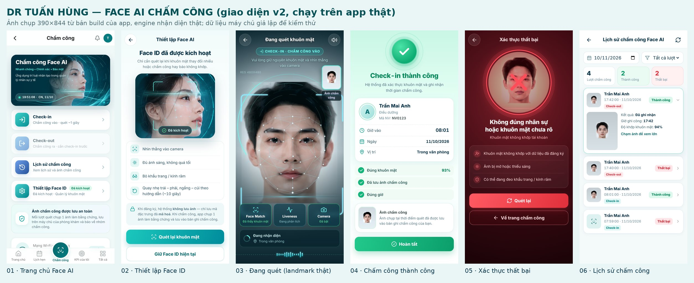

# Face ID chấm công — giao diện v2 (phong cách Face AI Ethics BOS)

Bản **cập nhật giao diện** trên tính năng Face ID đang chạy. Không đổi engine nhận diện,
dữ liệu khuôn mặt, API chấm công, quy tắc ca/đi muộn hay app shell.

## 1. Audit source hiện tại

| Thành phần | File / nguồn | Ghi chú |
|---|---|---|
| Stack | React 18 + Vite + Tailwind, Supabase | PWA web, dùng được trực tiếp `react/` của gói (chuyển sang JSX) |
| Engine | `features/faceid/faceEngine.js` (`@vladmandic/human`, model tự host `/models`) | Có **mesh landmark thật** (468 điểm) → lưới trên camera là dữ liệu thật |
| Camera | `getUserMedia` trong `FaceCameraScreen` / `FaceEnrollScreen` | Giữ nguyên, 1 phiên camera, tắt khi xong/lỗi/ra nền |
| Chấm công | Edge Function `face-attendance` qua `faceApi.submitFaceAttendance` | `action: CHECK_IN / CHECK_OUT`, `requestId` chống ghi 2 lần |
| Đăng ký | Edge Function `face-enroll`, bảng `face_profiles` | Trạng thái `ACTIVE / NEEDS_REENROLLMENT` |
| Lịch sử lượt quét | Bảng `face_attendance_audit` (RLS: chỉ thấy lượt của mình) | Có `ACCEPTED/REJECTED`, mã lỗi, % khớp, ảnh `snapshot_url` |
| Ảnh bằng chứng | `uploadToR2` → `attendance.check_in_photo/check_out_photo` | Thật — dùng cho dòng "Đã lưu ảnh chấm công" |
| Telegram | Server gửi sau khi accepted, **không trả trạng thái** | Không hiện chip "Đã gửi Telegram" (tránh trạng thái giả) |

## 2. File thay đổi

| File | Nội dung |
|---|---|
| `src/features/faceid/faceV2.css` | Toàn bộ style v2, tiền tố `.fv2-` (không đụng style app) |
| `src/features/faceid/FaceIdHome.jsx` | Màn 01: banner động + 4 thẻ Check-in / Check-out / Lịch sử / Thiết lập |
| `src/features/faceid/FaceCameraScreen.jsx` | Màn 03: chỉ thay phần hiển thị (HUD, vòng xoay, 3 ô trạng thái, sóng âm); pipeline giữ nguyên. Tắt camera khi có lỗi |
| `src/features/faceid/FaceResultScreens.jsx` | Màn 04 (xanh) / 05 (đỏ), dữ liệu thật từ server + hồ sơ |
| `src/features/faceid/FaceEnrollScreen.jsx` | Màn 02: Thiết lập Face AI; quy trình 5 tư thế giữ nguyên. Sửa câu chữ sai ("không lưu ảnh", "GPS/Wi-Fi") |
| `src/features/faceid/FaceHistoryScreen.jsx` | Màn 06: lịch sử lượt quét thật (thành công/thất bại, ảnh, % khớp) |
| `src/features/faceid/faceSound.js` | Âm thanh WAV scan/success/error (giải mã vào WebAudio), nút tắt tiếng, fallback tiếng cũ |
| `src/features/faceid/FaceHud.jsx` | Chặn lỗi bán kính âm làm canvas HUD ngừng vẽ |
| `src/pages/AttendancePage.jsx` | Thay khối "Chấm công hôm nay" bằng `FaceIdHome`; màn toàn trang render qua portal |
| `public/faceid/*` | Asset của gói: chân dung minh hoạ, vòng HUD, góc khung, sóng sáng, 3 file WAV |

## 3. Quy tắc nghiệp vụ được giữ

- **Check-in** và **Check-out** là 2 thẻ riêng, gửi `action` riêng tới cùng engine/server cũ.
- Check-in khoá khi hôm nay đã có giờ vào (như bản cũ — nút check-in biến mất sau khi vào).
  Check-out khoá khi chưa check-in (server cũng từ chối "Bạn chưa check-in hôm nay"); sau khi ra vẫn quét lại để cập nhật giờ ra.
- Màn thành công **chỉ** dựng khi server trả `accepted: true`; giờ/ngày lấy từ server.
- Nhân sự đã đăng ký giữ nguyên Face ID (`Đã kích hoạt`), không bị bắt đăng ký lại.

## 4. Kiểm thử (bản build thật của app, Chromium, camera giả bằng video khuôn mặt)

Engine Human chạy thật (lưới landmark trên ảnh màn 03 là điểm do engine trả về); Supabase giả lập ở tầng mạng.

| Kịch bản | Kết quả |
|---|---|
| Check-in → quét → server accepted | ✅ gửi `CHECK_IN`, 3 embedding, liveness PASSIVE, có ảnh; màn xanh đúng giờ server |
| Sau check-in | ✅ thẻ Check-in khoá "Đã vào 08:01", Check-out mở |
| Check-out → server từ chối (không khớp) | ✅ gửi `CHECK_OUT` (requestId khác); màn đỏ đúng lý do, không ghi công |
| Mất mạng khi gửi | ✅ màn đỏ "Không thể kết nối máy chủ" + **Thử gửi lại** dùng **cùng requestId** → thành công |
| Từ chối quyền camera | ✅ "Chưa có quyền dùng camera", hướng dẫn cấp quyền, không gửi server |
| Chưa đăng ký Face ID | ✅ thẻ Thiết lập "Chưa có"; bấm Check-in mở màn Thiết lập |
| Lịch sử | ✅ 4 lượt / 2 thành công / 2 thất bại, mở chi tiết + ảnh |
| 375×812, 390×844, 430×932, desktop 1280 | ✅ không tràn ngang, không lỗi console |
| `prefers-reduced-motion` | Animation tắt (CSS) |

Giới hạn môi trường test: máy test không có GPU nên engine chậm (~4 khung/giây khi quay video);
trên điện thoại thật nhanh hơn nhiều. Cần thử trực tiếp trên iPhone/Android của nhân sự trước khi phổ biến.

## 5. Rollback

Toàn bộ là frontend — revert commit/PR này là trở về giao diện cũ. Không có migration,
không đổi bảng/Edge Function, không chạm `face_profiles`.
